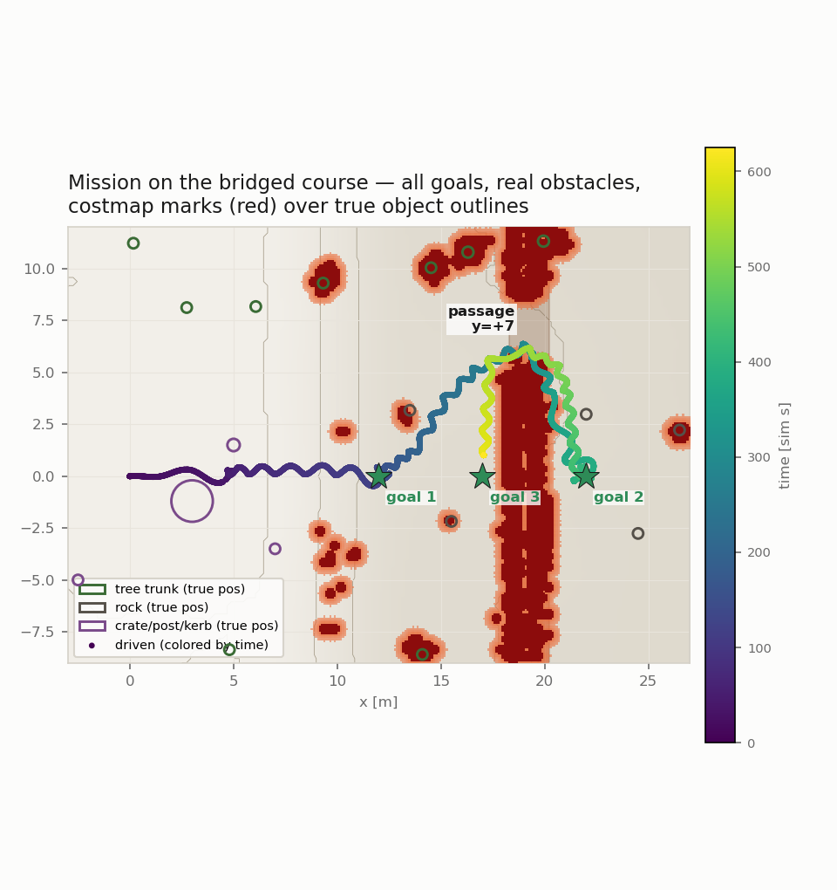
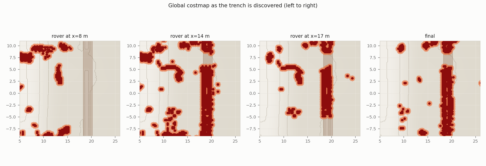
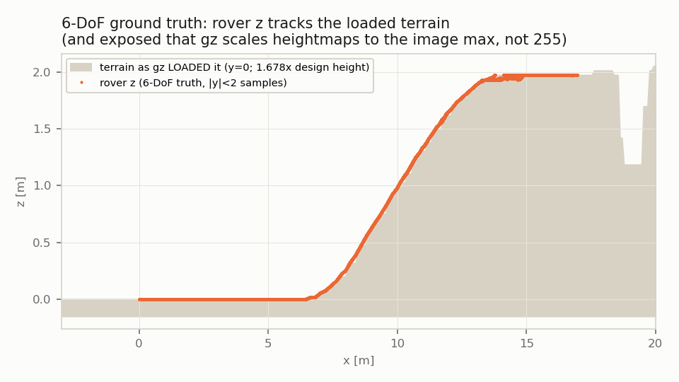
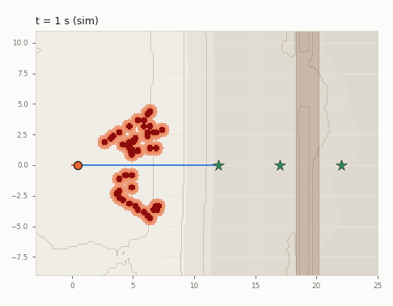
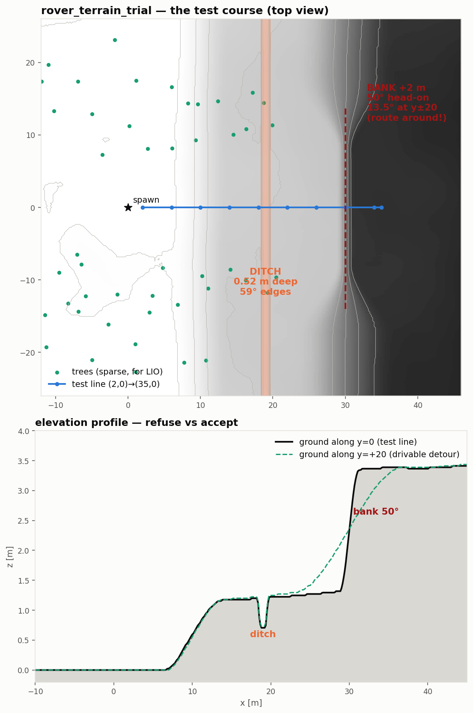
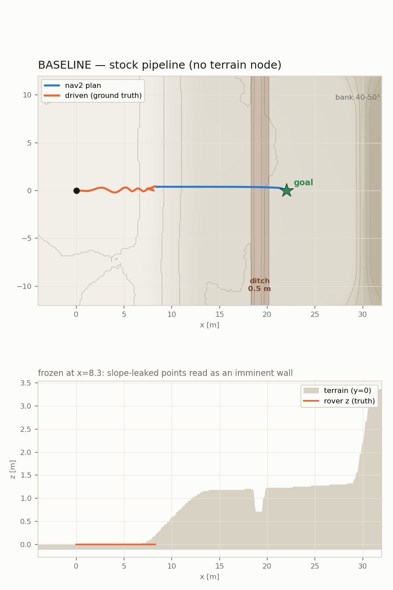
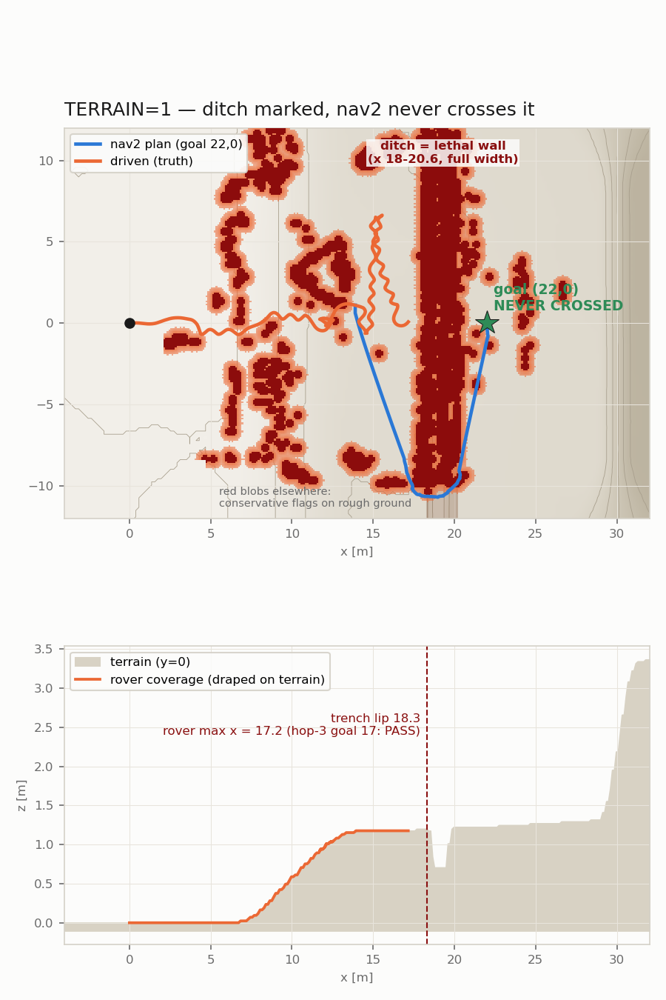
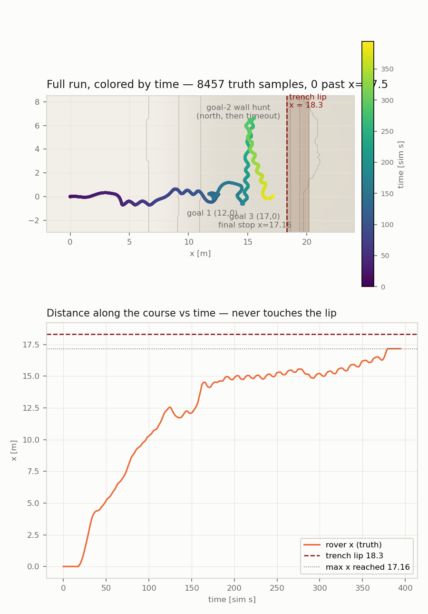
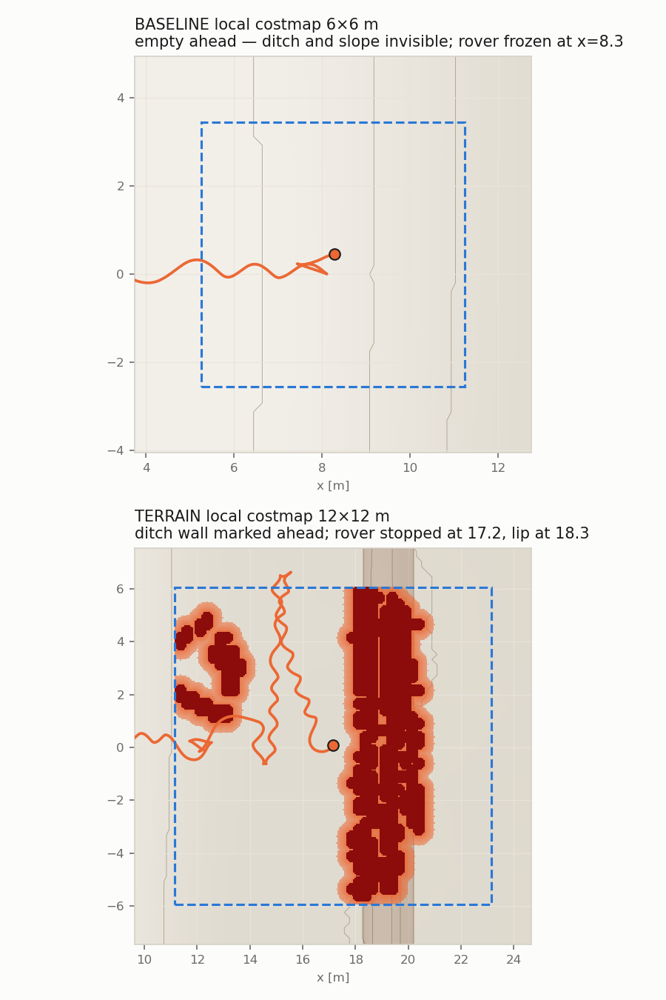

# Rover sim results — ditch & terrain tests (2026-08-01/02)

## NEW: mission on the bridged course — discovery validated

The trench got a 3 m land bridge at y=+7, inside the tree-free corridor.
Mission: goal 1 at 12 m (PASS), goal 2 at 22 m — **on the far side of the
trench** (PASS: nav2 mapped the trench as a wall, found the gap, crossed
it), goal 3 back at 17 m (re-crossed the bridge, timed out 1.3 m short of
the exact goal pose while parking). Real obstacle outlines (trees, rocks,
crates) are drawn under the costmap marks so alignment can be judged; the
trajectory is colored by time; all goals are marked.

How the trench appears as the rover explores — left to right (note the
bridge staying open at y≈7, and rough-ground false flags thinning as the
debounce and clearing catch up):

Answers to fair questions about these figures:

- **Why the wiggle?** MPPI runs a reduced sampling budget in sim (400x32
  at 8 Hz vs 1500x56 at 20 Hz on the Pi) — fewer samples = noisier best
  command at 0.3 m/s. Cosmetic at these speeds.
- **Red where nothing is drawn?** Mostly real 5-15 cm bumps in the
  procedural ground that trip the deliberately conservative 0.10 m step
  rule — the smooth backdrop just doesn't show them. Plus some leftover
  single-flicker marks the costmap never cleared (reduced by a 3-tick
  debounce, not eliminated).
- **The one engineering casualty of the week**: every mysterious "rover
  flip" during these tests traced to ONE call — setting the real-time
  factor on a live gz world via /world/<n>/set_physics corrupts heightmap
  collision (the rover climbs an invisible 49-degree ramp on flat ground
  until the physics wedges it). RTF caps are now written into the world
  file before launch.

## 2026-08-02: 6-DoF ground truth validated — and it caught a scale bug

The sim's "ground truth" used to be the drive plugin's wheel odometry —
flat (z always 0). The new source reads the true model pose from gz's
world pose stream. Validation: full missions with **zero physics wedges**
(the earlier "flips" traced to ONE call — setting the real-time factor on
a live world corrupts heightmap collision; now fixed pre-launch), and the
rover's z tracks the terrain:

The z-audit also exposed a real bug: **gz scales an image heightmap to
the image's own maximum pixel (152 here), not 255** — so the whole course
is 1.678x taller than designed (ramp ~21 deg, trench ~0.85 m), and the
MARSIM lidar world (generated with the 255 convention) is flatter than
the physics. Everything validated behaviorally still stands (harder
course than intended); fixing the generators is the top sim TODO.

The mission animated (rerun, 20 s per frame — costmap growing, plans in
blue, goals as stars; goal 1 reached to within 0.3 m, goal 3 PASS; the
goal beyond the trench ran out of time on the now-21-degree ramp and is
re-queued for after the scale fix):

---

## Original A/B test (2026-08-01, pre-bridge world)

## TL;DR

- **Without the terrain node:** the planner drew a path straight across the
  0.5 m trench — a hole returns no lidar points, so the costmap sees nothing
  there. The rover never even reached it: it froze halfway up the 13° ramp,
  because ground points that the segmenter mislabels on slopes looked like a
  wall to the collision monitor.
- **With the terrain node:** the rover climbed the ramp, the trench showed up
  in the costmap as a solid no-go wall from 6 m away, and nav2 never drove
  across it. Goals at 12 m and 17 m (1.3 m before the edge) both succeeded.
- Commits in the rover repo: `eb2d278`, `f5c9ef3`, `7639395`.

## 1 · The test course

A gentle 13° ramp, a 0.5 m trench crossing the whole map at x≈19, and a
40–50° bank at x≈30. Sparse trees, start pad at the origin.

## 2 · Baseline — blind to the ditch, stuck on the ramp

The blue plan goes straight over the trench. Orange is what the rover actually
did: froze at x=8.3 on the ramp (slope points leaking through ground
segmentation sat in the collision monitor's height band and read as an
obstacle dead ahead).

Fairness note: the ramp freeze is partly a sim artifact — the sim's "ground
truth" pose is planar (z always 0), so on the ramp MARSIM renders the lidar
from ~0.4 m too low, which exaggerates segmentation leakage (tracked in
TODO). A real rover might have climbed fine. The ditch blindness however is
fully real: a returns-only costmap cannot represent a hole, and the one run
that did reach the trench without the latched ditch flag drove straight in.

## 3 · Terrain node on — ditch marked, never crossed

The dark red band is the trench as nav2 now sees it. Goals at 12 m and 17 m
passed; for the goal beyond the trench the rover searched along the wall but
never drove over the edge (max x = 17.2 vs lip at 18.3).

Two things this figure can easily miscommunicate:

- **The blue plan is one frozen snapshot** (taken the moment the rover first
  passed x=14), so it starts where the rover was *at that instant* — not at
  the orange end dot, which is where the rover finished 15 minutes later
  after goal 3. In reality nav2 replans ~1×/s and the plan always starts at
  the robot.
- **That snapshot plan crosses the trench at its south end — through cells
  the lidar had never observed yet.** The planner treats never-seen ground
  as crossable, so it aimed for a "gap" beyond the mapped wall. As the rover
  drove toward it, the lidar saw more trench, the wall grew, and the gap
  kept retreating — which is why the rover wandered along the wall and never
  actually crossed. Executed behavior: safe. Drawn plan: optimistic about
  unseen ground. (nav2 can be told to treat unknown cells as blocked, at the
  cost of refusing to plan anywhere it hasn't looked yet.)

### Did it ever cross? No — here is the time-resolved proof

All 8457 ground-truth samples of the run: max x ever reached is **17.16 m**;
the trench lip is at **18.3 m**; zero samples past 17.5. The top panel colors
the trajectory by time; the bottom panel is distance-along-course vs time.

One thing the static figure hid: the "went left, then came back and stopped"
sequence was **two different goals from the test script**, not one decision
by the robot. Goal 2 (beyond the trench) ran for 7 minutes: nav2 kept
replanning toward apparent gaps past the mapped wall, the wall kept growing
as the lidar saw more trench, the controller kept refusing — then the script
cancelled it on timeout and sent goal 3 at (17, 0), which is the drive back
and the final parked position.

## 4 · Local costmap, side by side

Top: baseline 6×6 m window — empty ahead, nothing to stop for. Bottom:
terrain mode's 12×12 m window with the trench wall solidly marked.

## The "latched ditch" fix, in plain words

The node flags a ditch when it sees ground cells right next to cells it has
**never** gotten a lidar return from — a hole gives you nothing back, so
"known ground next to a blind spot" is the signature of a ditch. To avoid
false alarms, that check only ran in a band 3–8 m from the robot.

**The bug:** that band moves *with the robot*. Drive toward the trench and the
trench leaves the band — the node re-checked, the rule no longer applied, and
it erased its own warning right as the rover got close. Up close you can't
re-detect it either: the trench's near wall hides the floor from the lidar,
so you still get no returns — no new information at all. Version 1 drove
straight into the trench because of this.

**The fix:** once a cell is flagged as ditch, it stays flagged ("latched") as
long as those neighboring cells are still blind spots. The flag clears only
when actual returns arrive from there and show the ground is fine.
Warnings expire on evidence, not on distance.
