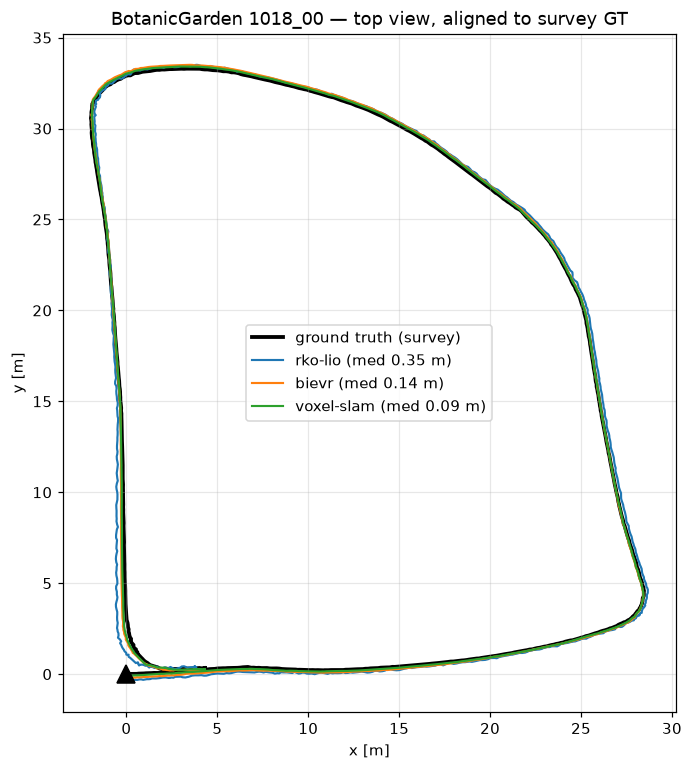
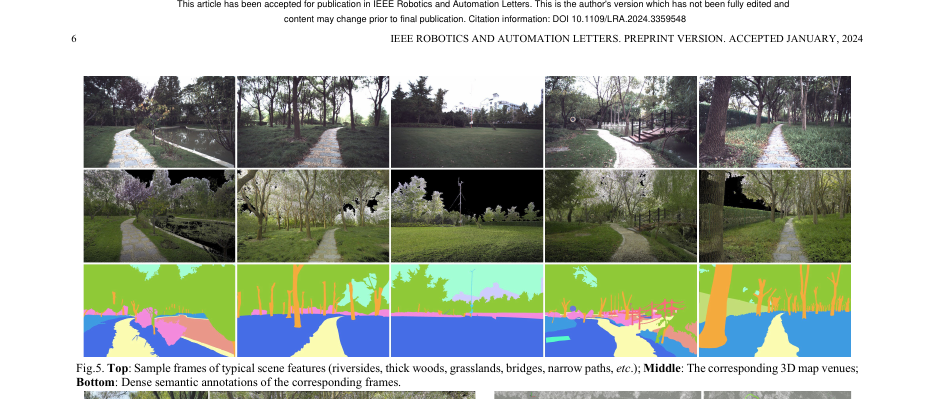
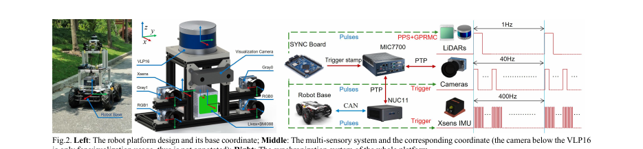

# BotanicGarden evaluation (real vegetation, survey ground truth)

Real garden dataset (Tongji Univ.), recorded with the rover's exact sensors
(Livox AVIA + BMI088). Ground truth: surveyed 3D map (11 mm) + lidar
localization, cm-grade even under canopy (NOT GPS).

## Sequence 1018-00 (115 m loop, woods/grass)

| method | median ATE | p95 | max | failures |
|---|---|---|---|---|
| Voxel-SLAM | **0.091 m** | 0.162 | 0.252 | 0 resets |
| BIEVR | **0.140 m** | 0.341 | 0.374 | 0 |
| RKO-LIO | 0.345 m | 0.576 | 0.694 | 0 |

Paper's own Fast-LIO2 (same AVIA lidar) on this sequence: 2.15 m ATE.

## The dataset

Sequence 1006-01 (766 m, the one that breaks lidar odometry — Fast-LIO2
39.7 m) still downloading; same three-way comparison will be added here.
