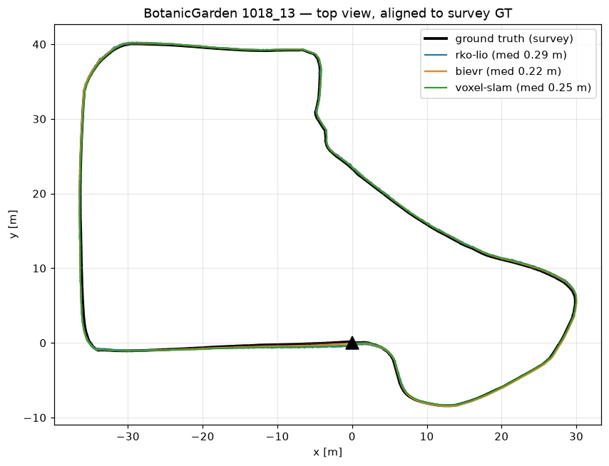
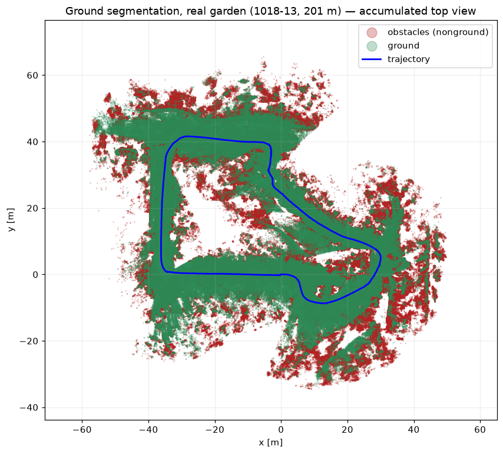
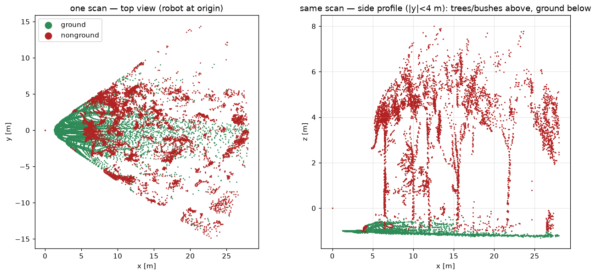
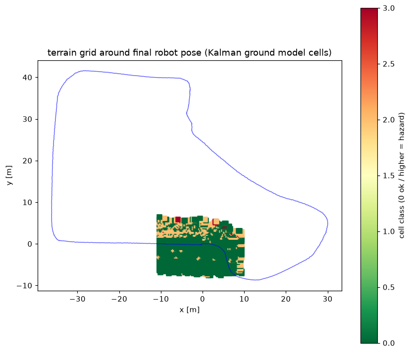

# Chapter: BotanicGarden (real garden vegetation, 3 tests)

Real botanic garden (Tongji Univ., Shanghai), recorded with the rover's EXACT
sensor pair — Livox AVIA + its built-in BMI088 IMU. Ground truth: the whole
garden surveyed with a tripod laser scanner (11 mm); robot poses from lidar
localization in that map, cross-checked to 0.6–2.3 cm. NOT GPS — GPS dies
under this canopy. Errors: median / p95 / max ATE (m) after rigid alignment.
Yardstick per test: the dataset paper's own Fast-LIO2 on the same lidar.

## What the garden looks like

---

## 1. Sequence 1018-00 — 115 m loop, woods/grass (easy)

| system | median | p95 | max | failures |
|---|---|---|---|---|
| **Voxel-SLAM** | **0.09** | 0.16 | 0.25 | 0 |
| BIEVR | 0.14 | 0.34 | 0.37 | 0 |
| RKO-LIO | 0.35 | 0.58 | 0.69 | 0 |
| Fast-LIO2 (paper) | 2.15 ATE | | | |

---

## 2. Sequence 1018-13 — 201 m, mixed (medium)

| system | median | p95 | max | failures |
|---|---|---|---|---|
| **BIEVR** | **0.22** | 0.64 | 0.65 | 0 |
| Voxel-SLAM | 0.25 | 0.70 | 0.71 | 0 |
| RKO-LIO | 0.30 | 0.71 | 0.76 | 0 |
| Fast-LIO2 (paper) | 2.39 ATE | | | |

---

## 3. Sequence 1006-01 — 766 m, dense vegetation (the lidar-killer)

The sequence where published lidar odometry collapses: Fast-LIO2 scored
39.7 m here, 10x worse than on any other sequence.

| system | median | p95 | max | failures |
|---|---|---|---|---|
| **Voxel-SLAM** | **0.60** | 2.04 | 2.14 | 1 reset, self-recovered |
| BIEVR | 2.09 | 3.95 | 4.17 | 0 |
| RKO-LIO | 3.35 | 7.05 | 7.23 | 0, graceful |
| Fast-LIO2 (paper) | 39.7 ATE | | | collapsed |

---

## Additional experiments (details in [BENCHMARK.md](BENCHMARK.md))

- **Compute** (same bag, desktop Ryzen 5 2600): RKO-LIO 9x real-time /
  0.19 GB · BIEVR 4.5x / 1.15 GB · Voxel-SLAM holds 2x replay / 2.13 GB.
- **Hybrid Voxel-SLAM + RKO prior**: no improvement (3 resets vs 1 stock).
- **Leak-free relocalization** (map 1018-00, queries 1018-13): Voxel-SLAM ✅
  11 matches, 0.18 m · BIEVR ❌ all seeds rejected · NDT ⚠️ 1/8 + honest
  no-fix; yaw-search gives confident WRONG poses in vegetation — keep off.
- **Ground segmentation** on real vegetation:

## Conclusion

In vegetation everything works and Voxel-SLAM wins: best accuracy on the
easiest and hardest tests (dominant on the killer), only system that
relocalizes cross-session, one benign reset in 1.1 km. BIEVR a consistent
second. RKO-LIO 3–6x less accurate but 10x cheaper and never misbehaves.
Neither sim failure mode appeared on real vegetation — see the TartanDrive 2
chapter for where they DO appear (fast featureless ground).
