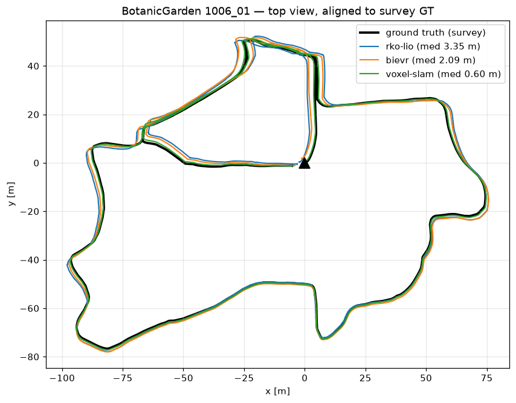

# BotanicGarden evaluation (real vegetation, survey ground truth)

Real garden dataset (Tongji Univ., RA-L 2024), recorded with the rover's exact
sensors: Livox AVIA lidar + its built-in BMI088 IMU. Ground truth: the whole
garden was surveyed with a tripod laser scanner (11 mm global accuracy); robot
poses come from lidar localization in that map, cross-checked to 0.6-2.3 cm.
NOT GPS — GPS dies under canopy; this doesn't.

All methods ran on identical raw data (lidar + IMU only, no cameras, no wheel
odometry). Errors are absolute trajectory error vs ground truth after rigid
alignment. Yardstick: the dataset paper's own Fast-LIO2 result on the same
AVIA lidar.

## Sequence 1018-00 — 115 m loop, woods/grass (easy)

| method | median | p95 | max | failures |
|---|---|---|---|---|
| Voxel-SLAM | **0.091 m** | 0.162 | 0.252 | 0 resets |
| BIEVR | 0.140 m | 0.341 | 0.374 | 0 |
| RKO-LIO | 0.345 m | 0.576 | 0.694 | 0 |
| Fast-LIO2 (paper) | 2.15 m ATE | | | |

## Sequence 1006-01 — 766 m, dense vegetation (the lidar-killer)

The sequence where published lidar-inertial odometry collapses: Fast-LIO2
scored 39.7 m ATE here (10x worse than on any other sequence).

| method | median | p95 | max | failures |
|---|---|---|---|---|
| Voxel-SLAM | **0.598 m** | 2.039 | 2.141 | 1 reset, self-recovered |
| BIEVR | 2.086 m | 3.945 | 4.167 | 0, never diverged |
| RKO-LIO | 3.346 m | 7.048 | 7.230 | 0, graceful degradation |
| Fast-LIO2 (paper) | 39.7 m ATE | | | collapsed |

## Takeaways so far

- Voxel-SLAM's sim reset-storm (35 resets / 109 m in the synthetic trunk
  forest) does NOT reproduce on real vegetation: 0 resets on 115 m, 1
  recoverable reset on 766 m. Real vegetation gives its plane detector more
  to hold onto than bare synthetic trunks.
- BIEVR's sim divergence on featureless ground also does not reproduce: on
  the real degenerate course it beat RKO-LIO and never diverged.
- Both sim failure modes were real but pessimistic. Real-world ranking:
  Voxel-SLAM > BIEVR > RKO-LIO on accuracy; all three survive.

## The dataset

Pending: hybrid (Voxel-SLAM fed with RKO-LIO prior), leak-free
relocalization test (map from 1018-00, query scans from 1018-13), ground
segmentation on real vegetation.
