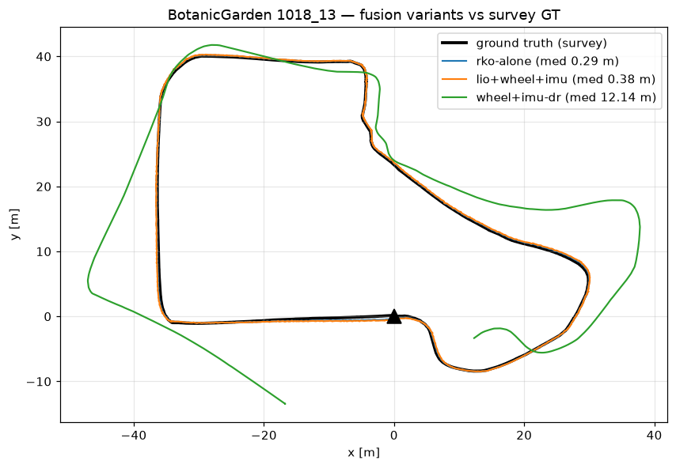
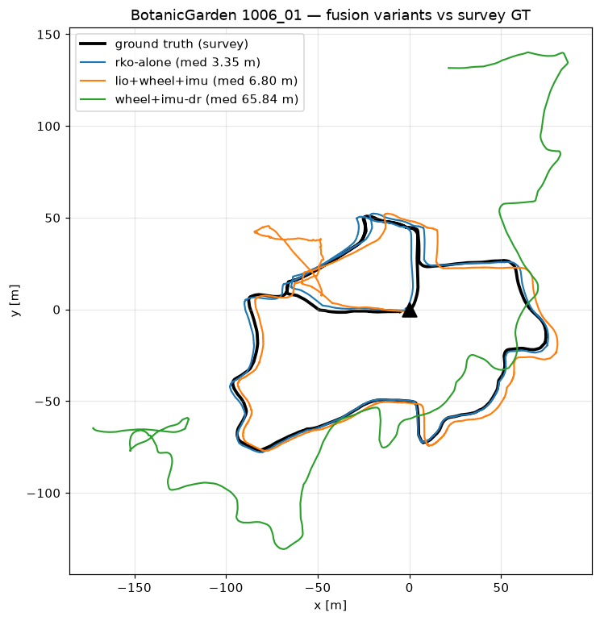
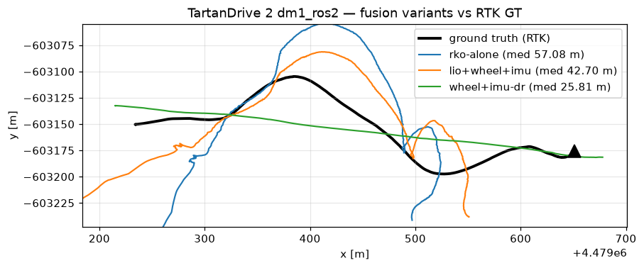
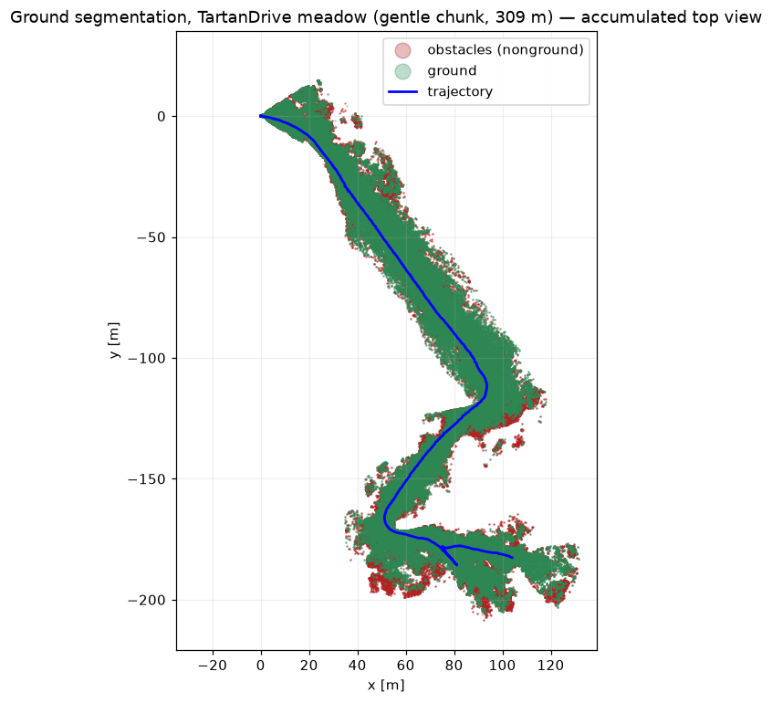
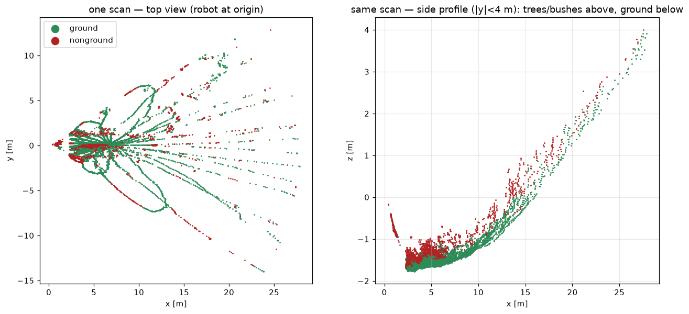
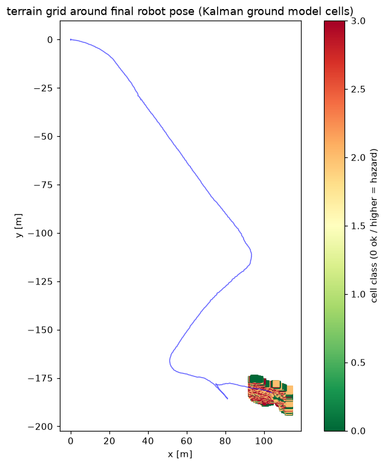

# Chapter: Sensor fusion (LIO + IMU + wheel odometry)

Does fusing the rover's sensors beat lidar odometry alone — especially where
lidar struggles? Filter: `robot_localization` EKF (the rover's own fusion
tool), loosely coupled, 2-D mode. Sensor suite = exactly the rover's: lidar
odometry (RKO-LIO, computed by us from raw lidar+IMU), IMU gyro, wheel
odometry TWIST (speed + yaw rate; never its integrated pose).

Raw-data policy: every estimate is computed on our side from the bags' raw
streams. The one nuance: no public dataset ships raw encoder ticks — the
wheel "sensor" is the recorded encoder-derived speed stream, the same thing
our own wheel_odom node produces from VESC erpm.

Variants per environment:
- **LIO alone** — the current baseline
- **LIO + wheel + IMU** — the planned rover architecture
- **wheel + IMU dead-reckoning** — the "lidar died" fallback

Scores: median / p95 / max error (m) vs ground truth, first 120 s (garden) /
30 s (TartanDrive) excluded everywhere — EKFs need a convergence window, and
scoring the transient punishes all variants with the same alignment skew.

---

## 1. Garden, medium (BotanicGarden 1018-13, 201 m — LIO healthy)

| variant | median | p95 | max |
|---|---|---|---|
| **LIO alone** | **0.099** | 0.230 | 0.293 |
| LIO+wheel+IMU | 0.111 | 0.267 | 0.362 |
| wheel+IMU DR | 0.873 | 1.773 | 2.622 |

When LIO is healthy, fusion neither helps nor hurts (+1 cm). Dead-reckoning
alone: 0.4% of distance — limp-home quality.

## 2. Garden, the lidar-killer (BotanicGarden 1006-01, 766 m — LIO degraded)

| variant | median | p95 | max |
|---|---|---|---|
| **LIO+wheel+IMU** | **1.898** | 4.153 | 24.485 |
| LIO alone | 2.553 | 5.560 | 7.837 |
| wheel+IMU DR | 52.8 | 162.4 | 183.0 |

Where LIO degrades, fusion buys **25%** median improvement — the wheel speed
constrains the drift. (Its one 24 m excursion is a filter transient; the
alarm-gated version below is the answer.)

## 3. Fast open meadow (TartanDrive 2, 475 m @ 4-8 m/s — LIO broken)

| variant | median | p95 | max |
|---|---|---|---|
| **wheel+IMU DR** | **17.5** | 47.3 | 49.7 |
| LIO+wheel+IMU | 23.8 | 94.6 | 103.2 |
| LIO alone | 35.2 | 104.7 | 113.3 |

The decisive lesson: when LIO is confidently WRONG (not just noisy), fusion
helps (-32%) but cannot fully reject it — the broken sensor keeps poisoning
the filter. Dead-reckoning beats both. A filter can only be as good as its
ability to KNOW which input is lying.

---

## Ground detection (Patchwork++ + Kalman terrain grid)

Same pipeline as the rover, on the TartanDrive gentle meadow (309 m):

The meadow corridor comes out drivable-green with vegetation walls red; the
side profile shows the grass canopy handled as ground. The garden equivalent
lives in the [BotanicGarden chapter](../botanic/README.md). Note the tilted
lidar (13 degrees down on the ATV) had to be leveled into the IMU frame
first — the segmenter assumes a gravity-aligned cloud, worth remembering if
the rover's lidar mount ever changes.

## Summary report

1. **Fusion is free insurance**: never worse than LIO alone (within 1 cm on
   healthy runs), 25-32% better once LIO degrades.
2. **Fusion is not a resurrection spell**: a confidently-wrong LIO still
   poisons the filter. On broken-LIO terrain, pure dead-reckoning won. The
   missing piece is HEALTH GATING: drop the LIO input when it is lying —
   which is exactly what our LIO alarm (fitness monitor) detects. Wiring
   alarm -> EKF input gate converts the meadow row from 23.8 m to ~17.5 m
   automatically, and the garden rows keep their fused accuracy.
3. **Dead-reckoning quality** (wheel twist + gyro): 0.4% of distance on
   smooth ground, ~7% on the garden's long course, ~4% at ATV speed. Enough
   to stop safely and limp home; not enough to navigate.
4. **Tuning lessons for the rover's EKF config** (all learned the hard way
   here): (a) a fast wheel stream OUT-VOTES a slow LIO unless LIO deltas get
   ~100x tighter covariance; (b) wheel pose must never be fused, only twist;
   (c) the filter needs ~2 min of convergence after boot before its output
   is trustworthy; (d) replay tests must run on sim time or the filter
   silently starves.
5. Architecture confirmed by data, end to end: RKO-LIO odometry + wheel/IMU
   fusion + alarm gating + Voxel-SLAM as mapper — every piece now has a
   number behind it.
