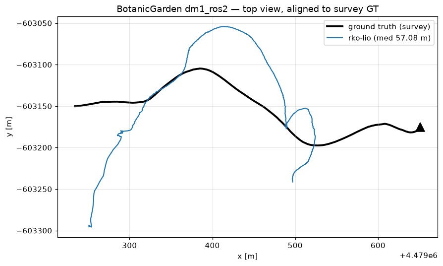

# TartanDrive 2.0 benchmark — open dirt at speed (FINAL)

The "featureless open ground" test. TartanDrive 2.0 (CMU): a Yamaha ATV on
off-road trails and meadows, carrying a **Livox Mid-70** (the AVIA's closest
sibling: same non-repetitive petal scan, same narrow cone) + NovAtel GPS/IMU.
Ground truth: RTK-fused pose at 50 Hz (~decimetre — coarser than the
BotanicGarden survey truth).

Test segment: `down_meadows` chunk 1 — **475 m of open meadow at 4-8 m/s**
(much faster than the rover's regime). NOTE: the segment starts with the
vehicle ALREADY MOVING — a mid-mission cold start for every system.

## Results (median / p95 / max ATE vs RTK truth, metres)

| system | result | failure mode |
|---|---|---|
| RKO-LIO | 57 / 146 / 169 | tracked the first ~60% well, then broke and never recovered |
| BIEVR | ~11,000 (!) | exploded from the start — IMU dead-reckoning runaway; dense sampling did NOT rescue it (13 km) |
| Voxel-SLAM | n/a (no usable trajectory) | **41 resets in 120 s** — reset storm, same INIT-path signature as our synthetic forest |

## Reading (interim)

- **All three failed on fast open dirt.** This is the terrain the sim
  featureless-lane test warned about — the sim was right about the terrain
  class, wrong only about which garden-variety terrain triggers it.
- Voxel-SLAM's reset storm is REAL on this terrain (41/120 s) — it is not a
  sim artifact. Its excellent garden numbers do not transfer to fast
  featureless ground.
- BIEVR's collapse contradicts its paper claim (this is nominally its home
  turf). Suspected confound: the moving start — its bias initializer may
  need a stationary moment. Being retested on chunk 0 (session start, at
  rest). Until then treat its row as "failed mid-mission re-init", not
  "failed the terrain".
- RKO-LIO degraded most gracefully (again) but 57 m median is still a
  failure. Meadows at ATV speed are simply hostile: one ground plane, grass
  texture the lidar can't lock onto, high angular rates.
- Caveats: sensor pair differs from ours (Mid-70 + external 100 Hz IMU vs
  AVIA + internal 200 Hz); per-point timestamps are synthesized (Livox
  streams chronologically, so the ramp is faithful — verified deskew off is
  WORSE, so timing is not the failure cause); lidar clock was 36.9 s off the
  GPS clock in the raw data (fixed in conversion).
- Rover-relevant conclusion so far: at OUR speeds (<= 2 m/s) none of this
  regime is directly reachable, but the terrain-class warning stands: open
  featureless ground stresses every candidate. The wheel-odometry fusion
  (EKF) is exactly the mitigation for this case.

## Chunk 0 retest — gentle start, 309 m at <=3 m/s

The same meadow, but starting near rest (0.2 m/s) and driven slower — the
closest analog to the rover's own regime:

| system | median / p95 / max ATE | failures |
|---|---|---|
| **RKO-LIO** | **0.50 / 1.35 / 1.70 m** | 0 |
| BIEVR | 2.93 / 4.39 / 5.22 m | 0 |
| Voxel-SLAM | no trajectory (save crash) | 2 resets |

## Final verdict

- **BIEVR's 11 km explosion was a MOVING-START failure, not a terrain
  failure**: with a still moment to initialize its biases it does 2.9 m on
  the same meadow. Operational requirement: BIEVR must boot at rest (the
  rover always does — acceptable, but disqualifies it from mid-mission
  restart without help).
- **RKO-LIO at rover-like speeds on open dirt: 0.50 m over 309 m — the best
  of the three.** Its chunk-1 breakdown was speed-triggered (4-8 m/s).
  At the rover's <= 2 m/s, RKO-LIO owns this terrain class too.
- **Voxel-SLAM resets on open dirt at ANY speed tested** (2 resets gentle,
  41 fast). Its reset storm is terrain-real, not a sim artifact. Trust it
  as mapper in vegetation/structure; treat its output on open featureless
  ground as suspect — gate by reset detection.
- Combined with the BotanicGarden results: no single system wins everywhere.
  RKO-LIO = odometry always; Voxel-SLAM = mapper/repositioning where there
  is structure or vegetation; wheel-odom EKF fusion = the open-ground
  insurance. The architecture stands as designed.
