# Chapter: TartanDrive 2.0 (fast off-road, 7 terrain types)

CMU's off-road dataset: a Yamaha ATV at 3–10 m/s (well above rover speeds),
carrying a **Livox Mid-70** — the AVIA's closest sibling (same non-repetitive
petal scan, same narrow cone) — plus NovAtel GPS/IMU. Ground truth: RTK-fused
pose at 50 Hz (~decimetre). One ~120 s chunk tested per scene, session-start
(at-rest) chunks except where noted. Same three systems, identical raw data.

Data notes (all fixed in our converter): Livox clock 36.9 s off the GPS
clock; no per-point timestamps (synthesized ramp — validated: deskew-off is
worse); Mid-70→IMU extrinsic from their calibration.

## 1. What it looks like

**Turnpike — the main dirt trail:**
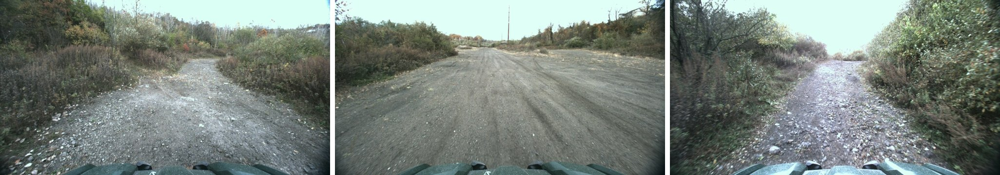
**Gupta — wooded trail (closest to forest driving):**
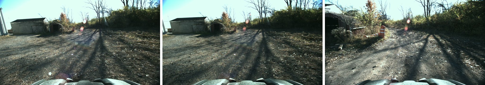
**Figure-8 — flat open field (purest featureless case):**
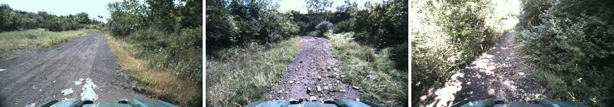
**Slag heap — steep barren rock (closest public analog to burned terrain):**
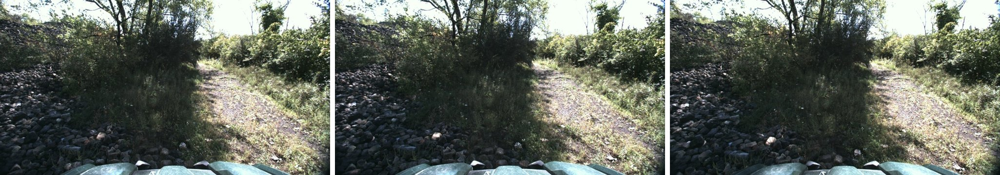
**Warehouse — trail past structures:**
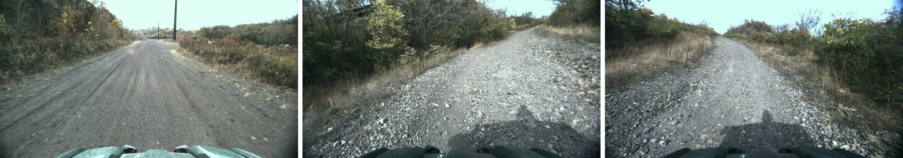
**Down meadows — open meadow:**
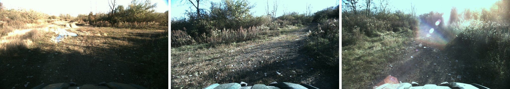

## 2. Estimated trajectories vs ground truth

Black = RTK truth; colored = estimates (rigid-aligned). Voxel-SLAM appears
only where its save survived (its multi-session crash loses trajectories on
heavy-reset runs).

| | |
|---|---|
| 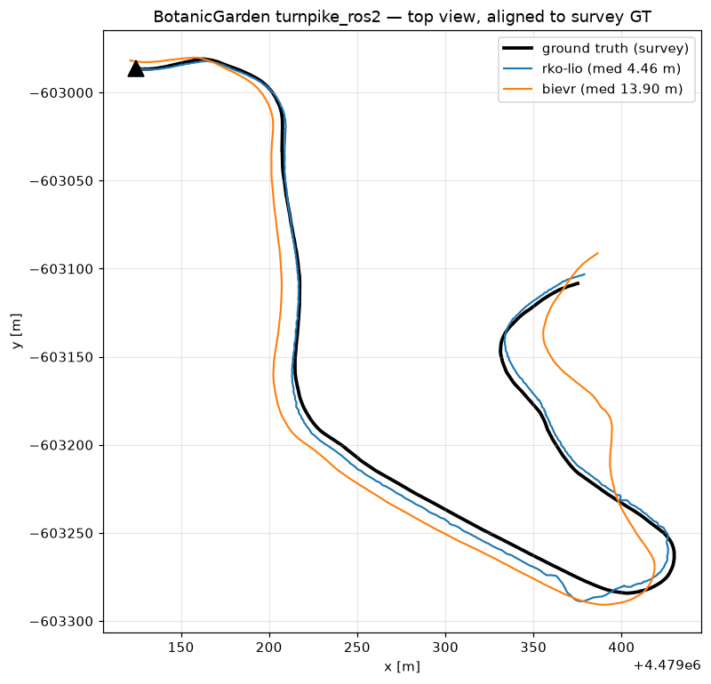 | 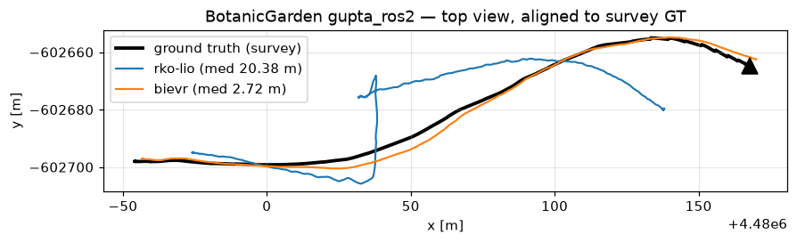 |
| 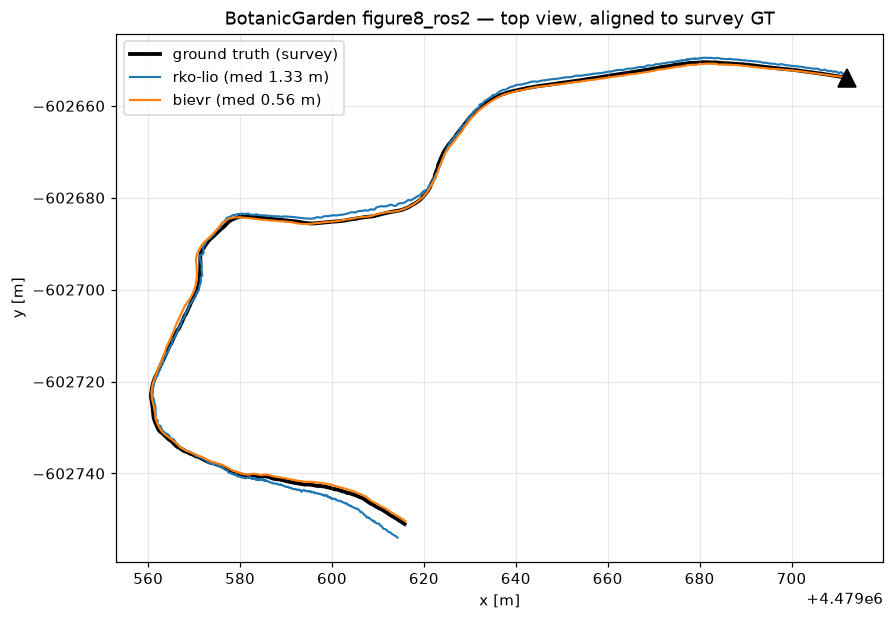 | 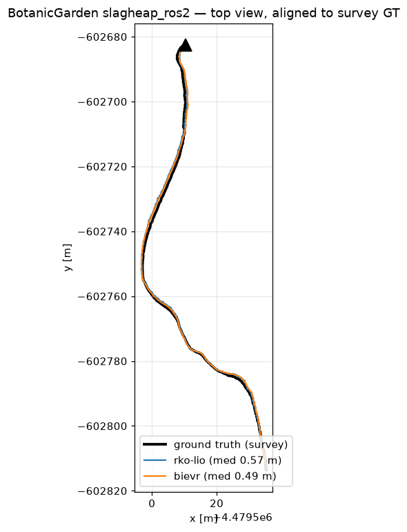 |
| 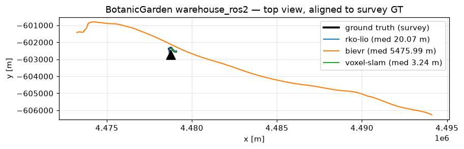 | 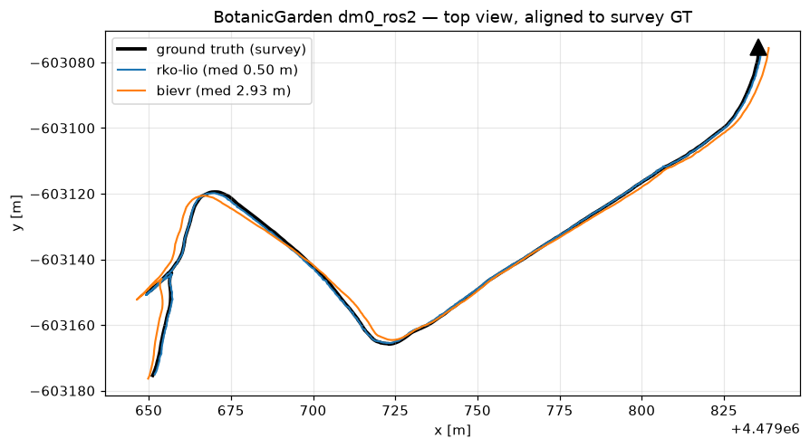 |

Meadow at full ATV speed with a moving start (the stress case):
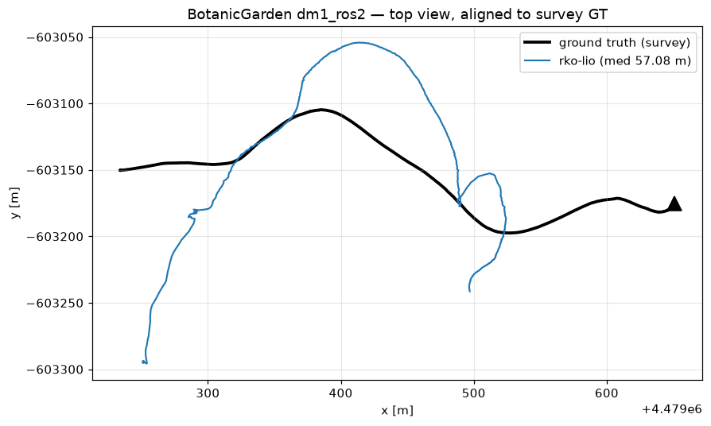

## 3. Results table

Median / p95 ATE vs RTK truth (m); Voxel-SLAM shown as reset count (its
failure signature — each reset is a pose discontinuity):

| scene | terrain | RKO-LIO | BIEVR | Voxel-SLAM |
|---|---|---|---|---|
| slag heap | steep barren | 0.57 / 0.97 | **0.50 / 0.92** | 4 resets |
| figure-8 | flat field | 1.34 / 2.93 | **0.56 / 1.32** | 7 resets |
| meadow (gentle, ≤3 m/s) | open meadow | **0.50 / 1.35** | 2.93 / 4.39 | 2 resets |
| turnpike | dirt trail | **4.46 / 7.33** | 13.90 / 31.78 | 46 resets |
| gupta | wooded trail | 20.38 / 34.19 | **2.72 / 5.03** | 24 resets |
| warehouse | structures, fast | **20.07 / 79.34** | 5476 (exploded) | 67 resets |
| meadow (fast, moving start) | open meadow | 57.08 / 145.9 | 11,144 (exploded) | 41 resets |

## 4. Conclusion

- **No single winner.** BIEVR takes flat/featureless and wooded trail
  (its bump-image design shows); RKO-LIO takes gentle meadow and stays
  least-bad when things get violent; both break at full ATV aggression.
- **BIEVR's two explosions both trace to initialization** (moving start /
  aggressive early motion). When it initializes cleanly it never diverged.
  Operational rule: BIEVR must boot at rest.
- **Voxel-SLAM reset-storms on every fast scene** (4–67 resets). Its sim
  reset disease is terrain-real: fast motion + weak structure. Use it as a
  mapper only where vegetation/structure exists, always behind reset
  detection — never as control-loop odometry off-road.
- **Slag heap is the happiest surprise**: steep barren rock — the nearest
  thing to burned forest in any public dataset — was EASY (both ≤0.57 m).
  Terrain relief feeds the lidar. Burned, rolling terrain is likely
  friendlier to LIO than flat grass.
- Speeds here are 3–10× the rover's. At rover-like pace (gentle meadow row)
  every system behaves; the failures live at speeds we don't drive. The
  terrain-class lessons, not the absolute numbers, are the takeaway.
